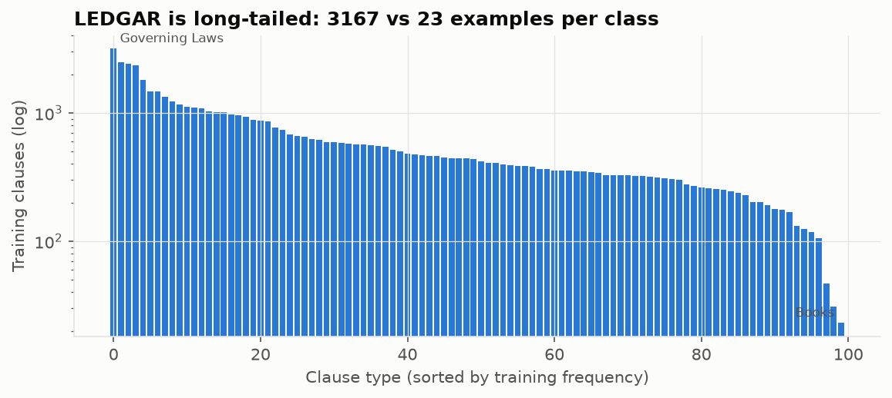
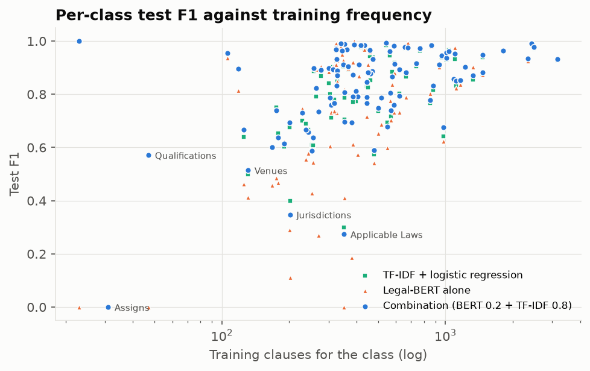
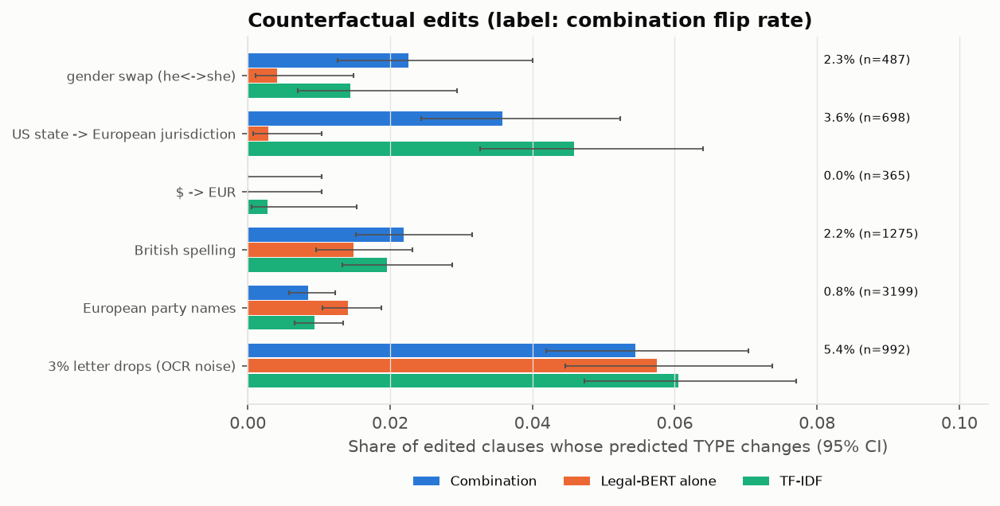

# Cœur NLP d'un assistant de revue de contrats

Prototype de classification de clauses contractuelles, de recherche dans une banque de clauses et d'audit des modes de défaillance, construit sur LEDGAR (LexGLUE).

> **Statut : prototype de recherche.** Il fonctionne sur des clauses **anglaises** de contrats américains (déclarations SEC). Il n'est validé ni sur le droit européen, ni sur le français ou l'allemand. Il ne remplace pas un juriste (voir [Usages interdits](#11-usages-autorisés-et-interdits)).

## En bref

| | Résultat sur le test LEDGAR (10 000 clauses) |
|---|---|
| **Système livré** : combinaison Legal-BERT (poids 0,2) + TF-IDF (0,8) | micro-F1 **88,43 %** [87,78 ; 89,06], macro-F1 **82,84 %** [81,57 ; 83,76] |
| TF-IDF + régression logistique (baseline) | 87,70 % / 82,19 % |
| Legal-BERT fine-tuné seul (2 époques, 256 tokens) | 86,35 % / 76,27 % |
| Gain de la combinaison sur TF-IDF | **modeste** : +0,73 pt micro-F1 [+0,51 ; +0,98], +0,65 pt macro-F1 [+0,31 ; +1,00] |
| Abstention (seuil fixé sur la validation) | 84,2 % des clauses traitées, **94,5 % de classifications correctes parmi les clauses traitées** |
| Recherche (clause → clauses similaires) | P@1 77,4 %, P@10 66,4 % (même type LEDGAR) |
| Principales faiblesses | classes rares, labels quasi synonymes, clauses de bail (*real estate*), requêtes « préavis de N jours » |

Les intervalles entre crochets sont des intervalles de confiance bootstrap à 95 % (1 000 rééchantillonnages des clauses du test). Les chiffres sont ceux de la version actuelle (§13 pour l'historique).

---

## Sommaire
1. [Problème métier et exigences](#1-problème-métier-et-exigences)
2. [Données](#2-données-ledgar)
3. [Architecture](#3-architecture)
4. [Reproduire et démontrer](#4-reproduire-et-démontrer)
5. [Entraînement : choix et compromis](#5-entraînement--choix-et-compromis)
6. [Résultats de classification](#6-résultats-de-classification)
7. [Recherche dans la banque de clauses](#7-recherche-dans-la-banque-de-clauses)
8. [Audit des biais et des défaillances](#8-audit-des-biais-et-des-défaillances)
9. [Comparaison externe (LexGLUE)](#9-comparaison-externe-lexglue)
10. [Reproductibilité](#10-reproductibilité)
11. [Usages autorisés et interdits](#11-usages-autorisés-et-interdits)
12. [Limites et suite](#12-limites-et-suite)
13. [Versions des résultats](#13-versions-des-résultats)

---

## 1. Problème métier et exigences

Pendant une due diligence, un juriste lit chaque clause, en identifie le type (droit applicable, résiliation, indemnisation…), cherche des précédents dans la banque de clauses du cabinet et signale les formulations inhabituelles. Le cœur NLP doit :

1. **classer** chaque clause dans un des types de la check-list ;
2. **retrouver** les clauses les plus proches, à partir d'une clause collée ou d'une question (« show me termination clauses with a 30-day notice period ») ;
3. **prouver** qu'il fonctionne (globalement, par type de clause, par type de contrat et de partie), et dire clairement ce pour quoi il ne doit pas servir.

Les clients européens exigent des résultats reproductibles, une évaluation documentée et un audit des modes de défaillance. D'où les choix suivants :
- tous les paramètres sont choisis sur la validation ;
- toutes les variantes sont rapportées ;
- le système s'abstient quand il n'est pas sûr ;
- les caches sont liés aux empreintes des modèles et des données.

## 2. Données (LEDGAR)

`coastalcph/lex_glue`, configuration `ledgar`, révision figée `c23fdff1…`. Ce sont des clauses de contrats déposés à la SEC américaine. LexGLUE en fait un découpage **chronologique** : train 60 000 (2016–2017), validation 10 000 (2018), test 10 000 (2019). Il y a **100 types de clauses** et une seule étiquette par clause.

Constats de l'exploration ([reports/eda.json](reports/eda.json), `uv run nlp-final-project eda`) :

| Constat | Valeur | Conséquence |
|---|---|---|
| Déséquilibre | *Governing Laws* : 3 167 exemples, *Books* : 23 (ratio 138) | macro-F1 rapporté en plus du micro-F1 ; analyse tête / milieu / queue |
| Longueur | médiane 103 tokens ; 11,9 % > 256 ; 1,9 % > 512 | troncature à 256 tokens (compromis, §5) |
| Doublons | 920 dans le train ; **282 clauses du test identiques à une clause du train** | scores rapportés aussi sans ces doublons |
| Labels contradictoires | 3 textes identiques avec des labels différents | bruit d'étiquetage marginal |
| Dérive temporelle | divergence de Jensen-Shannon train/test 0,078 (train/val 0,045) | le test mesure déjà un peu de dérive |
| Pronoms (proxy) | uniquement *he* : 2 073 clauses ; uniquement *she* : 201 ; les deux : 721 | données déséquilibrées sur le genre |
| Juridictions (proxy) | État américain : 6 159 ; hors États-Unis : 253 | quasi aucune clause européenne |



## 3. Architecture

```
clause ──► Legal-BERT fine-tuné (256 tokens) ──► logits ─► softmax(·/T_bert) ──┐ poids 0,2
      └──► TF-IDF 1-2 grammes + rég. logistique ► logits ─► softmax(·/T_tfidf) ──┤ poids 0,8
                                                                                 ▼
                       score max ≥ seuil (fixé sur la validation) ? → type prédit : sinon « à revoir par un juriste »

question / clause ──► bge-small-en-v1.5 (cosinus) ─┐
                 └──► BM25 (matrice creuse) ───────┴─► fusion par rangs (RRF) ─► filtre « N jours » ─► top-k
```

| Module | Rôle |
|---|---|
| [`train.py`](src/nlp_final_project/train.py) | boucle PyTorch écrite à la main : tokenisation, lots groupés par longueur avec padding dynamique, AdamW + warm-up linéaire, validation à chaque époque, checkpoints reprenables |
| [`baseline.py`](src/nlp_final_project/baseline.py) | TF-IDF + régression logistique |
| [`inference.py`](src/nlp_final_project/inference.py) | **interface commune** aux 3 variantes (évaluation, audit, CLI `classify`) ; paramètres choisis sur la validation ; refus d'artefacts dont l'empreinte a changé |
| [`evaluate.py`](src/nlp_final_project/evaluate.py) | évaluation des 3 variantes sur le test |
| [`retrieval.py`](src/nlp_final_project/retrieval.py) | index dense + BM25 + fusion, filtre de durée, évaluation |
| [`audit.py`](src/nlp_final_project/audit.py), [`perturb.py`](src/nlp_final_project/perturb.py), [`slices.py`](src/nlp_final_project/slices.py) | audit par groupes, contrefactuels, entrées hors périmètre |
| [`fingerprint.py`](src/nlp_final_project/fingerprint.py) | empreintes SHA-256 et caches auto-invalidants |

La configuration d'inférence complète est versionnée dans [reports/inference_config.json](reports/inference_config.json). Elle contient l'ordre des labels, les empreintes des poids et du tokenizer, les températures, le poids et les seuils.

## 4. Reproduire et démontrer

Prérequis : [uv](https://docs.astral.sh/uv/). Les dépendances sont verrouillées dans `uv.lock`.

```bash
uv sync
```

| Étape | Commande | Durée (Apple M3, 16 Go) |
|---|---|---|
| Exploration | `uv run nlp-final-project eda` | ~1 min |
| Baseline TF-IDF | `uv run nlp-final-project baseline` | ~4 min (CPU) |
| Fine-tuning Legal-BERT | `uv run nlp-final-project train` | **~2 h 30** (GPU intégré M3) |
| Reprise après interruption | `uv run nlp-final-project train --resume` | — |
| Évaluation (3 variantes) | `uv run nlp-final-project evaluate` | ~7 min la 1re fois, puis secondes (cache) |
| Index + évaluation de la recherche | `uv run nlp-final-project index` | ~5 min la 1re fois |
| Audit | `uv run nlp-final-project audit` | ~10 min |
| Tout sauf l'entraînement | `uv run nlp-final-project all` | refuse de s'exécuter si les modèles manquent ; **n'entraîne jamais** |
| Tests | `uv run pytest` | ~1 min 30 (69 tests) |

**Artefacts lourds.** Les poids (440 Mo), le modèle TF-IDF (146 Mo), les embeddings (90 Mo) et les logits sont dans `artifacts/`, exclu de Git. On les reconstruit avec `baseline`, `train`, `evaluate` puis `index`. Les rapports (`reports/`) sont versionnés. Un rapport n'est jamais réécrit à partir d'un cache dont l'empreinte ne correspond plus.

### Démonstration en trois commandes

```bash
uv run nlp-final-project classify "This Agreement shall be governed by the laws of the State of New York."
```
```bash
uv run nlp-final-project search "either party may terminate on thirty days written notice" -k 5
```
```bash
uv run python -c "import json; d=json.load(open('reports/eval_metrics.json')); [print(v, r['test']['micro_f1'], r['test']['macro_f1'], r['abstention']['test_coverage']) for v, r in d['variants'].items()]"
```

La requête de démonstration ci-dessus, proche du texte des clauses, renvoie cinq clauses *Terminations* avec préavis de 30 jours. La question vitrine d'origine, « show me termination clauses with a 30-day notice period », **échoue** (§7) : la recherche est sensible à la formulation, et cette démo n'en est pas une validation.

`classify` affiche le type prédit, les 3 meilleurs candidats avec leur score et l'éventuelle abstention (`--json` pour une sortie machine, `--variant bert|tfidf` pour comparer). **Le score de confiance estime la probabilité que le TYPE de clause soit correct. Ce n'est pas une probabilité que la clause soit juridiquement valide, opposable ou sans risque.**

## 5. Entraînement : choix et compromis

| Choix | Valeur | Raison |
|---|---|---|
| Modèle | `nlpaueb/legal-bert-base-uncased` (révision `15b570cb…`) | LEDGAR est en anglais : CamemBERT (français) n'est pas adapté. Legal-BERT est pré-entraîné notamment sur des contrats américains. |
| Longueur max | **256 tokens** (88 % des clauses entières) | 512 tokens provoquait une saturation mémoire (16 Go partagés CPU/GPU) et doublait le coût |
| Époques | **2** (~1 h 15 par époque) | budget de calcul sur un portable sans GPU dédié |
| Optimisation | AdamW, lr 3e-5, warm-up 6 %, décroissance linéaire jusqu'à 0, batch 16, clipping 1,0, bfloat16 | recette BERT standard |
| Sélection | meilleur macro-F1 de validation (époque 2) | la métrique la plus sensible aux classes rares |

Courbe : validation 84,18 / 74,02 après l'époque 1, puis 86,37 / 77,58 après l'époque 2 (micro / macro-F1).

**Pourquoi Legal-BERT seul est sous le baseline : hypothèses, pas causes prouvées.** Legal-BERT seul est sous TF-IDF, surtout sur les classes rares (macro-F1 de la queue : 61,9 % contre 74,3 %). Deux hypothèses ont des indices, sans preuve :
- **Entraînement trop court.**
  - Pour : le macro-F1 de validation montait encore nettement entre l'époque 1 et l'époque 2 (74,0 → 77,6) ; le taux d'apprentissage est descendu à 0 en 2 époques alors que LexGLUE autorise 20 époques avec arrêt anticipé ; les classes rares, vues le moins souvent, sont les plus touchées.
  - Contre ou non vérifié : une seule graine, et pas d'époque 3 pour observer un plateau.
- **Troncature à 256 tokens.**
  - Pour : sur les clauses de plus de 200 mots, BERT perd 3,9 points d'exactitude face à TF-IDF (86,4 contre 90,3), contre 0,3 point sur les clauses de 31 à 80 mots (audit, §8).
  - Contre : seules 11,9 % des clauses dépassent 256 tokens, ce qui ne peut pas expliquer tout l'écart.
- **Autres explications non exclues** : hyperparamètres (taux d'apprentissage, taille de lot), variance entre graines, labels quasi synonymes. Aucune expérience comparative n'a été menée pour les départager (voir §12).

**Reprise d'entraînement.** Un checkpoint est écrit toutes les 300 étapes, de façon atomique. Il contient les poids, l'optimiseur, le scheduler, la position dans l'époque, les états aléatoires et la configuration. La reprise est **refusée** si la configuration diffère. En particulier, `--resume --epochs 3` ne peut pas prolonger le run actuel : son scheduler a été construit pour 2 époques et le taux d'apprentissage est déjà à 0. Le checkpoint existant, écrit avant cette sécurité, n'a pas de configuration enregistrée, il est donc refusé (vérifié). **Ce qui est vérifié** (`tests/test_resume.py`) : sur CPU, avec un mini-BERT local et du dropout actif, un entraînement interrompu puis repris donne **exactement** le même état qu'un entraînement continu. L'égalité est vérifiée pour les paramètres, l'état de l'optimiseur, le scheduler, les compteurs d'étapes, la meilleure métrique et les états aléatoires Python, NumPy et torch. Trois points d'interruption sont testés : milieu d'époque, dernière étape avant la validation, début de l'époque suivante.

Ce test a révélé un défaut : chaque création d'itérateur `DataLoader` consommait le générateur aléatoire **global**. Une reprise, qui crée un itérateur de plus, désynchronisait donc le dropout. Sans le correctif (un générateur dédié par `DataLoader`), 2 des 3 scénarios divergent. Le run Legal-BERT livré n'a jamais été repris, il n'est donc pas affecté.

**Non vérifié** : l'identité d'une reprise sur MPS ou en bfloat16.

## 6. Résultats de classification

Tous les paramètres d'inférence sont choisis **sur la validation uniquement** (`fit_inference_config`) :
- les températures de calibration ;
- le poids BERT de 0,2, retenu sur une grille de 0 à 1 par pas de 0,05 au meilleur macro-F1 ;
- un seuil d'abstention **par variante**, au plus bas niveau qui atteint 95 % de classifications correctes sur la validation.

Le test n'a servi à aucun réglage.

**Définitions.**
- **Macro-F1** : moyenne sur l'**univers fixe des 100 labels**, avec F1_c = 2TP / (nombre de vrais + nombre de prédits). Un label sans aucun exemple, ni vrai ni prédit, compte 1, puisqu'aucune erreur n'est possible sur lui. La même définition sert pour les scores ponctuels, le bootstrap simple, le bootstrap apparié et le choix du poids.
  - Ce choix compte sur la **validation**, où *Books* est absent. BERT, qui ne prédit jamais *Books*, obtient 77,80 avec cette convention et 76,80 si l'on comptait 0 ; la combinaison et TF-IDF prédisent *Books* une fois, la convention ne les touche pas.
  - Sur le **test**, les 100 labels sont présents : les scores ponctuels ne dépendent pas de la convention.
- **Bootstrap** : rééchantillonnage par **clause**. LEDGAR n'a pas d'identifiant de contrat, donc la corrélation entre clauses d'un même contrat est ignorée et les intervalles sont probablement un peu trop étroits.
- **Seuil d'abstention** : candidats = groupes complets de confiances égales ; on retient le plus bas seuil dont l'ensemble **réellement accepté par `>=`** atteint la cible. Si aucun ensemble non vide ne l'atteint, le seuil vaut `null` et la variante s'abstient sur tout ; la CLI et les JSON l'indiquent explicitement. L'ancienne version coupait parfois au milieu d'un groupe d'égalités : son seuil TF-IDF acceptait 8 328 clauses de validation à 94,993 %, sous la cible.

Détail complet : [reports/eval_metrics.json](reports/eval_metrics.json) ; scores par classe (précision, rappel et F1 de chaque variante) : [reports/per_class_test.csv](reports/per_class_test.csv).

| Variante | micro-F1 test [IC 95 %] | macro-F1 test [IC 95 %] | sans doublons train (n = 9 718) | macro-F1 tête / milieu / queue |
|---|---|---|---|---|
| **Combinaison** | **88,43** [87,78 ; 89,06] | **82,84** [81,57 ; 83,76] | 88,11 / 82,49 | 90,4 / 83,6 / 74,8 |
| TF-IDF | 87,70 [87,02 ; 88,37] | 82,19 [80,93 ; 83,12] | 87,36 / 81,83 | 89,8 / 82,8 / 74,3 |
| Legal-BERT seul | 86,35 [85,66 ; 87,02] | 76,27 [75,20 ; 77,63] | 86,14 / 76,10 | 89,6 / 77,7 / 61,9 |

**Comparaisons appariées** (mêmes clauses ; IC bootstrap de la différence) :

| | Δ micro-F1 | Δ macro-F1 | McNemar (désaccords correct/incorrect) |
|---|---|---|---|
| Combinaison − TF-IDF | +0,73 pt [+0,51 ; +0,98] | +0,65 pt [+0,31 ; +1,00] | 106 contre 33, p = 4·10⁻¹⁰ |
| Combinaison − BERT | +2,08 pt [+1,54 ; +2,60] | +6,57 pt [+5,20 ; +7,51] | 466 contre 258, p = 9·10⁻¹⁵ |
| BERT − TF-IDF | −1,35 pt [−1,93 ; −0,77] | −5,92 pt [−6,88 ; −4,50] | 362 contre 497, p = 5·10⁻⁶ |

Le gain de la combinaison sur TF-IDF est **réel mais modeste**. Le test de McNemar porte sur le taux d'erreur (exactitude) : **ce n'est pas un test du macro-F1**. Pour le macro-F1, seul l'IC bootstrap apparié est rapporté.

**Erreurs de la combinaison.**
- Principales confusions : *Applicable Laws → Governing Laws* (33), *No Waivers → Waivers* (23), *Tax Withholdings → Withholdings* (20), *Modifications → Amendments* (18), *Integration → Entire Agreements* (17). Ce sont des **labels quasi synonymes** de LEDGAR : l'erreur tient autant à la taxonomie qu'au modèle.
- Classes les plus faibles (F1, effectif test) : *Assigns* 0,00 (4), *Applicable Laws* 0,27 (53), *Jurisdictions* 0,35 (29), *Venues* 0,51 (20), *Qualifications* 0,57 (5), *Agreements* 0,59 (48).

**Calibration et abstention** (chaque variante avec son propre seuil) :

| Variante | ECE test | Seuil | Couverture validation → test | Classifications correctes parmi les clauses traitées (test) | Correctes parmi les clauses écartées |
|---|---|---|---|---|---|
| Combinaison | 0,017 | 0,709 | 84,1 % → 84,2 % | **94,5 %** | 56,0 % |
| Legal-BERT | 0,029 → 0,020 (T = 1,04) | 0,851 | 76,5 % → 76,4 % | 94,8 % | 59,0 % |
| TF-IDF | 0,024 → 0,024 (T = 0,91) | 0,756 | 83,3 % → 83,2 % (83,26 % / 83,21 %) | 94,6 % | 53,5 % |

La cible de 95 % est atteinte sur la validation, pas tout à fait sur le test (94,5 %). **Ce n'est pas une garantie sur le test ni sur de futurs contrats**, a fortiori sur des contrats d'un autre type ou d'une autre juridiction.




## 7. Recherche dans la banque de clauses

**Banque** : les 59 080 clauses du train, sans doublons exacts. **Encodeur** : `BAAI/bge-small-en-v1.5` (révision `5c38ec7c…`, 384 dimensions, 256 tokens), avec recherche exacte par produit scalaire. Au-delà de quelques millions de clauses, on passerait à FAISS. **BM25** : implémentation vectorisée, vérifiée contre la formule de référence par un test. **Hybride** : fusion par rangs réciproques (RRF, k = 60).

Deux protocoles **séparés** :

**A. Clause → clauses similaires.** 981 clauses du test servent de requêtes, avec au plus 10 par classe pour que les classes rares comptent. Un résultat est pertinent s'il a le même label LEDGAR. Les doublons exacts de la requête sont retirés.

| Mode | P@1 | P@5 | P@10 | MRR@10 |
|---|---|---|---|---|
| Dense | 76,6 % | 68,5 % | 64,8 % | 0,814 |
| BM25 | 77,0 % | 68,4 % | 64,6 % | 0,817 |
| **Hybride** | **77,4 %** | **70,1 %** | **66,4 %** | **0,824** |

Labels les plus mal servis (P@10 hybride) : *Assigns* 5 %, *Agreements* 10 %, *Miscellaneous* 15 %, *Applicable Laws* 18 %, *Jurisdictions* 21 %, *Venues* 22 %.

**B. 40 questions écrites à la main.** Elles ont été rédigées par l'équipe **avant** de voir les résultats, avec pour chacune la liste des labels acceptés (labels quasi synonymes acceptés ensemble), et n'ont pas été modifiées depuis. Ce n'est **pas un benchmark juridique indépendant** : les questions et les critères viennent de ceux qui ont construit le système. Résultats question par question : [reports/retrieval_questions.json](reports/retrieval_questions.json).

| Mode | P@1 | `precision_at_10` (÷ 10) | `precision_among_returned` | Résultats renvoyés (moy.) | Mention de la durée demandée (4 questions, ÷ 10) |
|---|---|---|---|---|---|
| Dense | 85,0 % | 87,5 % | 87,5 % | 10 | 67,5 % |
| BM25 | 82,5 % | 83,0 % | 83,0 % | 10 | 90,0 % |
| Hybride | 92,5 % | 89,3 % | 89,3 % | 10 | 92,5 % |
| Hybride + filtre de durée | 95,0 % | 89,0 % | 89,0 % | 10 | 100 % (par construction) |

`precision_at_10` divise toujours par 10 : un résultat manquant compte comme un échec. `precision_among_returned` divise par le nombre de résultats renvoyés. Ici, chaque question a renvoyé 10 résultats, donc les deux sont égaux. La pertinence est **approchée par le label LEDGAR** : un résultat est « pertinent » si son label est dans la liste acceptée, qu'il réponde ou non vraiment à la question.

**Changement depuis la version archivée.** P@1 du mode hybride + filtre : 92,5 % → 95,0 %. La question « notice of termination of at least 60 days » passe de 0 à 1, parce que le classement se fait désormais parmi les seules clauses admissibles (règles ci-dessous). Ce n'est pas une règle conçue pour une question, mais la mesure porte sur des questions **déjà vues** : c'est un contrôle de non-régression, pas une validation.

**Échecs, en particulier sur la question vitrine.**

| Question | P@1 | P@10 | Constat |
|---|---|---|---|
| « show me termination clauses with a 30-day notice period » | **0** | **0,1** | 1er résultat = clause *Notices*. Les « 30 days » y sont un délai pour notifier une « Good Reason », **pas un préavis de résiliation**. Seul le 4e résultat est une clause *Terminations*. |
| « notice of termination of at least 60 days » | 0 | 0,4 | le filtre impose exactement 60 jours : « au moins » n'est pas compris |
| « termination for convenience with ninety days written notice » | 1 | 0,5 | les 3 premiers sont corrects, puis viennent des clauses *Terms* |
| « payment due within 30 days of invoice » | 1 | 0,9 | bon |

**Règles de classement** ([`retrieval.py`](src/nlp_final_project/retrieval.py)) :
1. Les filtres (durée, label) définissent d'abord l'ensemble des clauses **admissibles**.
2. Chaque signal ne classe que des clauses admissibles au score informatif : toutes pour le dense ; pour BM25, seulement celles dont le score est strictement positif (un score nul signifie aucun mot commun).
3. La fusion RRF porte sur les 200 premiers de chaque classement. Une clause classée par aucun des deux signaux n'a pas de score et **n'est jamais renvoyée**. La liste peut donc contenir moins de k résultats ; la CLI le signale.
4. Les égalités sont départagées par la position dans la banque, de façon déterministe.
5. Une requête avec plusieurs durées garde par défaut les clauses qui en mentionnent **au moins une** (`--period-match any`), ou **toutes** avec `--period-match all`.

Avant ce correctif, la fusion se faisait sur toute la banque puis on filtrait. Une clause admissible hors des 200 premiers recevait un score de 0 et pouvait être renvoyée sans aucun classement informatif. De plus, un corpus de moins de 200 clauses faisait planter la recherche. Les deux cas sont couverts par des tests.

**Limites du filtre de durée (`day_periods`).**
- Il vérifie qu'une clause **mentionne** une durée de N jours, **pas le rôle juridique** de cette durée (préavis, paiement, délai de remédiation…).
- Il ne distingue pas jours ouvrés et jours calendaires.
- Il ignore les nombres en toutes lettres absents de sa liste (« thirty-one days ») et ne gère pas « au moins / au plus ».

Le score de 100 % ne démontre donc **aucune compréhension du préavis**. Ces limites sont fixées par des tests (`tests/test_units.py::test_day_periods_known_limits`) pour qu'un changement soit visible. Une requête dont aucune clause ne passe le filtre renvoie explicitement « aucune clause ».

## 8. Audit des biais et des défaillances

Résultats complets : [reports/audit.json](reports/audit.json). La combinaison est au premier plan, BERT et TF-IDF sont rapportés à côté. Chaque variante utilise **son propre** seuil d'abstention.

**Précautions de lecture.**
- Les groupes (famille de contrat, pronoms, juridiction) sont des **proxys calculés par mots-clés** sur le texte de la clause ([`slices.py`](src/nlp_final_project/slices.py)). Ce ne sont ni des métadonnées fiables ni des attributs personnels certifiés, et une clause peut être mal rangée.
- Les petits groupes (n < 100) ont des intervalles trop larges pour conclure à de l'équité ou à de la discrimination.
- « Attendu d'après le mix » = l'exactitude que prédirait la seule composition en types de clauses du groupe. L'écart ajusté est **descriptif, pas causal**. Il vaut 0 par construction pour les groupes de fréquence de classe.

### 8.1 Performance par groupe (combinaison)

| Groupe | n | Exactitude [IC 95 %] | Attendu d'après le mix | Écart | Couverture | Correctes parmi les clauses traitées |
|---|---|---|---|---|---|---|
| **Immobilier / bail** | 266 | **75,2** [69,7 ; 80,0] | 84,3 | **−9,2** ⚠ | 72,9 % | **87,6 %** |
| Commercial / PI | 357 | 86,0 [82,0 ; 89,2] | 88,9 | −2,9 | 79,6 % | 95,1 % |
| Emploi | 1 936 | 86,6 [85,0 ; 88,1] | 87,7 | −1,1 | 79,5 % | 94,7 % |
| Générique | 4 613 | 88,5 [87,6 ; 89,4] | 89,6 | −1,1 ⚠ | 86,1 % | 93,8 % |
| Crédit / finance | 2 285 | 91,1 [89,8 ; 92,2] | 87,4 | +3,7 | 86,3 % | 96,2 % |
| M&A / titres | 543 | 91,0 [88,3 ; 93,1] | 87,4 | +3,6 | 84,0 % | 95,4 % |
| Pronoms *he* | 299 | 83,6 [79,0 ; 87,4] | 87,0 | −3,3 | 76,9 % | 94,8 % |
| Pronoms *she* | 37 (petit) | 86,5 [72,0 ; 94,1] | 85,0 | +1,5 | 75,7 % | 92,9 % |
| *he* et *she* | 143 | 79,7 [72,4 ; 85,5] | 84,2 | −4,5 | 71,3 % | 90,2 % |
| Juridiction hors États-Unis | 36 (petit) | 91,7 [78,2 ; 97,1] | 89,2 | +2,5 | 83,3 % | 96,7 % |
| Clauses ≤ 30 mots | 1 349 | 86,3 [84,3 ; 88,0] | 88,3 | −2,1 ⚠ | 81,6 % | 93,3 % |
| Classes de queue | 1 283 | 75,2 [72,8 ; 77,5] | — | — | 72,1 % | **84,3 %** |

⚠ = exactitude sous l'attendu au-delà de l'IC à 95 %.

Ce qu'on peut affirmer :
- **Clauses de bail** : nettement sous l'attendu pour les trois variantes (−8 à −10 points). Même après abstention, seulement 87,6 % des clauses traitées sont correctes. C'est le défaut le plus net.
- **Classes rares** : l'abstention ne suffit pas (84,3 % de classifications correctes parmi les clauses traitées, loin des 95 %).

Ce qu'on ne peut pas affirmer :
- **Pronoms** : le groupe *she* (37 clauses) est trop petit pour conclure, dans un sens comme dans l'autre. Les écarts des groupes *he* et *he et she* sont dans les intervalles.


### 8.2 Contrefactuels : le type de clause change-t-il ?

Les règles de transformation sont volontairement prudentes : les cas ambigus sont exclus plutôt que mal transformés. Des exemples avant/après tirés au hasard sont sauvegardés dans `audit.json` et ont été relus. **Remplacer une juridiction ou une devise change le contenu juridique** : un type stable ne signifie pas que la clause a les mêmes effets.

| Édition | n | Changement de type (combinaison) [IC 95 %] | BERT | TF-IDF |
|---|---|---|---|---|
| Genre *he* ↔ *she* | 487 | 2,3 % [1,3 ; 4,0] | 0,4 % | 1,4 % |
| État américain → juridiction européenne | 698 | 3,6 % [2,4 ; 5,2] | 0,3 % | 4,6 % |
| $ → EUR | 365 | 0,0 % [0,0 ; 1,0] | 0,0 % | 0,3 % |
| Orthographe britannique | 1 275 | 2,2 % [1,5 ; 3,2] | 1,5 % | 2,0 % |
| Noms de sociétés européennes | 3 199 | 0,8 % [0,6 ; 1,2] | 1,4 % | 0,9 % |
| 3 % de lettres supprimées (OCR) | 992 | 5,4 % [4,2 ; 7,0] | 5,7 % | 6,0 % |

Exemples de basculements :
- *Governing Laws* devient *Waiver Of Jury Trials* quand « Delaware » est remplacé par une juridiction européenne : c'est un type clé de la check-list.
- *Organizations* devient *Authority* en orthographe britannique : le modèle s'appuie sur l'orthographe américaine du mot-clé.

La partie TF-IDF rend la combinaison plus sensible au genre et à la juridiction que BERT seul, parce que ces mots sont des n-grammes discriminants.

Limites des transformations : « Inc., a Dutch corporation » reste grammatical mais peu plausible. Une clause qui oppose déjà le dollar à une autre devise peut devenir incohérente après « dollars → euros ».



### 8.3 Entrées hors périmètre

Les 8 entrées testées n'ont pas de bonne réponse dans LEDGAR : RGPD, force majeure, non-concurrence, clauses en français ou en allemand, un e-mail, une recette.
- La **combinaison s'abstient sur les 8**.
- **Legal-BERT seul répond « General » avec 0,90 de confiance à la clause RGPD** : c'est une erreur confiante, que son seuil ne bloque pas.
- Les clauses françaises et allemandes reçoivent des labels arbitraires (*Death*, *Interpretations*…) avec une confiance faible.

L'échantillon est minuscule. **Un seuil de confiance réduit ces erreurs mais ne garantit pas de les détecter.**

### 8.4 Recherche

| Constat | Valeur |
|---|---|
| P@10 hybride par famille (150 requêtes chacune) | crédit 79,6 %, M&A 77,1 %, emploi 71,3 %, générique 71,0 %, commercial 68,3 %, **bail 59,9 %** |
| Exposition des familles hors famille de la requête | proche de leur part dans la banque ; crédit sous-représenté (17,9 % des résultats contre 26,2 % de la banque) |
| Genre *he* ↔ *she* sur 300 requêtes | Jaccard moyen du top-10 : 0,85 ; listes identiques dans 44 % des cas ; P@10 67,8 % → 67,5 % : **les précédents montrés changent** même si la pertinence reste stable |
| Composition de la banque | 3,5 % des clauses ne contiennent que *he*, 0,3 % que *she* : les précédents montrés à un juriste sont majoritairement au masculin |

## 9. Comparaison externe (LexGLUE)

Source primaire : Chalkidis et al., *LexGLUE: A Benchmark Dataset for Legal Language Understanding in English*, ACL 2022 ([arXiv:2110.00976](https://arxiv.org/abs/2110.00976), v4, tableau 3). Scores test LEDGAR (micro-F1 / macro-F1) : TF-IDF + SVM 87,0 / 81,4 ; BERT 87,6 / 81,8 ; **Legal-BERT 88,2 / 83,0**.

**Comparabilité.** Le jeu de données et le test sont les mêmes (découpage LexGLUE), mais le protocole diffère :
- LexGLUE : jusqu'à 20 époques avec arrêt anticipé, 512 tokens, batch de 8, fp16 ; meilleure de 5 graines selon la validation ; SVM sur 1-3 grammes avec recherche de grille.
- Ici : 2 époques, 256 tokens, une seule graine ; régression logistique sur 1-2 grammes.

La comparaison est donc **indicative**. Notre baseline TF-IDF (87,7 / 82,2) est du même ordre que le leur. Notre Legal-BERT (86,4 / 76,3) est nettement en dessous du leur : c'est compatible avec les hypothèses du §5 (entraînement court, troncature), mais l'écart de protocole empêche d'en isoler la cause.

## 10. Reproductibilité

| Élément | Valeur |
|---|---|
| Dépendances | verrouillées par `uv.lock` ; Python **3.14.0b4** (version bêta gérée par uv : à remplacer par une 3.14 stable), torch 2.14.1, transformers 5.20.2, datasets 5.1.0, sentence-transformers 6.2.0, scikit-learn 1.9.1, numpy 2.5.4 |
| Données / modèles | révisions Hugging Face figées dans [`config.py`](src/nlp_final_project/config.py) : LEDGAR `c23fdff1…`, Legal-BERT `15b570cb…`, bge-small `5c38ec7c…` |
| Graine | 42 (Python, NumPy, PyTorch ; ordre des lots dérivé de la graine et de l'époque) |
| Matériel | MacBook Apple M3, 16 Go, GPU intégré (MPS), macOS 26.6 ; entraînement en 146 min |
| Caches | chaque fichier de logits est stocké avec l'empreinte du modèle, du tokenizer, de la longueur max et des données ; l'index avec celle de l'encodeur, de sa révision et de la banque. Toute différence entraîne un recalcul. `Predictor` refuse une configuration dont une empreinte ne correspond plus. |
| Vérifications effectuées | logits recalculés avec la nouvelle interface identiques aux anciens (écart 0,0) ; scores de référence retrouvés au centième ; inférence clause par clause identique au cache sur M3 (écart 0,0) ; sur CPU (float32 au lieu de bfloat16), écart max 0,012 (BERT), aucun label changé sur 200 clauses ; index reconstruit avec des métriques identiques |
| Limites du déterminisme | bfloat16 et noyaux MPS : non garantis bit à bit d'une machine à l'autre ; un ré-entraînement donnera des scores proches, pas identiques |

**Politique des caches** :
- **Logits** : la clé contient l'identité des poids et du tokenizer, mais aussi le **contexte numérique** (appareil, précision bfloat16 ou float32, versions de torch et transformers, règle de batching) et la version du schéma d'inférence. Des poids identiques calculés ailleurs ne donnent pas des nombres identiques : passer du CPU au GPU MPS/CUDA **recalcule** les logits, il ne les réutilise jamais.
- **Index de recherche** : les embeddings de la banque sont un artefact stocké, au même titre que des poids. Ils sont **réutilisés** d'un appareil à l'autre (les réencoder sur CPU prendrait de l'ordre d'une heure) ; leur contexte de construction est enregistré et tout écart est signalé sur stderr.
- **Inférence sur un autre appareil** : `classify` avertit sur stderr quand les seuils ont été choisis sur des logits d'un autre contexte.

**Tests** (`uv run pytest`, 69 tests) :

| Fichier | Besoin d'artefacts | Contenu |
|---|---|---|
| `test_units.py` (36) | non | seuils (égalités, cible impossible, confiance 1, tout correct, couverture nulle), macro-F1 (classe qui disparaît), classement filtré (moins de k, aucun candidat, corpus < profondeur, égalités, plusieurs durées), filtre de durée, BM25, perturbations, caches, reprise refusée |
| `test_cli.py` (18) | non | `--help` de chaque commande dans un dossier vide (rien n'est écrit), arguments invalides (`-k 0`, requête vide), `all` sans modèles, contexte numérique et invalidation |
| `test_resume.py` (4) | non (CPU, mini-modèle local) | reprise = run continu, à 3 points d'interruption |
| `test_artifacts.py` (11) | **oui** (ignorés si `artifacts/` est vide) | ordre des labels, poids 0,2, seuils par variante, seuils qui atteignent la cible sur l'ensemble réellement accepté, reproduction des scores, refus d'une configuration périmée, inférence brute contre cache, CLI `classify --json` et `search` |

## 11. Usages autorisés et interdits

**Usage prévu** : aide au tri de clauses **anglaises** de contrats de type SEC, avec relecture humaine. Les clauses sous le seuil de confiance vont à un juriste ; la recherche de précédents sert de point de départ.

**Ne pas utiliser pour :**
- décider seul du type ou de la portée d'une clause, ou remplacer l'avis d'un avocat ;
- des contrats de **droit européen** ou d'autres juridictions : non validé, très peu d'exemples non américains ;
- des clauses en **français, en allemand** ou dans une autre langue que l'anglais : aucune garantie ;
- détecter les risques, les clauses abusives ou les manquements de façon exhaustive : le système classe des types, il n'évalue pas la conformité ;
- des types de clauses absents de LEDGAR (RGPD, force majeure, non-concurrence…) : le système ne sait pas les reconnaître ;
- retrouver un préavis précis : le filtre de durée ne comprend pas le rôle de la durée (§7) ;
- tirer des conclusions d'équité sur des personnes : les groupes de l'audit sont des proxys textuels.

## 12. Limites et suite

- **Legal-BERT seul reste sous le baseline TF-IDF.** Un entraînement trop court et la troncature sont des hypothèses argumentées (§5), pas des causes établies. La combinaison ne gagne qu'environ 0,7 point.
- Les **labels quasi synonymes** de LEDGAR (Governing / Applicable Laws, Waivers / No Waivers…) plafonnent les scores. Une check-list métier les fusionnerait sans doute.
- **Clauses de bail et classes rares** : performance et abstention insuffisantes.
- Recherche : les questions avec contrainte de durée échouent sur la notion de préavis ; une extraction structurée (rôle + durée + type de jours) serait nécessaire.
- Python 3.14 en bêta, une seule graine, une seule machine.

**Expérience proposée, séparée et soumise à accord** : ré-entraîner Legal-BERT à 512 tokens avec plus d'époques et arrêt anticipé, et plusieurs graines. Cela prendrait plusieurs heures sur ce Mac. Ce serait une expérience distincte, avec son propre scheduler, évaluée selon le même protocole (paramètres choisis sur la validation, test consulté une seule fois), sans réajuster les choix actuels sur le test déjà consulté.

---

## 13. Versions des résultats

| Version | Où | Ce qui la distingue |
|---|---|---|
| **Actuelle** | `reports/*.json`, `reports/figures/` | seuils à égalités complètes, macro-F1 sur l'univers fixe de 100 labels, recherche filtrée classée parmi les clauses admissibles, contexte numérique dans les caches |
| Avant stabilisation | [reports/archive/2026-10-22_before_stabilisation/](reports/archive/2026-10-22_before_stabilisation/) | inférence commune, 3 variantes, audit complet (commit `2f581da`) |
| Initiale | [reports/archive/2026-10-21_initial/](reports/archive/2026-10-21_initial/) | avant l'inférence commune |
| Références externes | §9 | LexGLUE, protocole différent |

**Ce qui a changé entre « avant stabilisation » et « actuelle »** (aucun réentraînement ; les logits recalculés sont identiques bit à bit, donc **aucune prédiction n'a changé**) :

| Grandeur | Avant | Actuelle | Cause |
|---|---|---|---|
| Scores ponctuels test (3 variantes) | inchangés | inchangés | — |
| IC macro-F1 combinaison | [81,57 ; 83,72] | [81,57 ; 83,76] | définition du macro-F1 dans le bootstrap |
| IC macro-F1 TF-IDF | [80,89 ; 83,03] | [80,93 ; 83,12] | idem |
| IC macro-F1 BERT | [75,20 ; 77,47] | [75,20 ; 77,63] | idem |
| IC Δ macro combinaison − BERT | [+5,26 ; +7,51] | [+5,20 ; +7,51] | idem |
| IC Δ macro BERT − TF-IDF | [−6,88 ; −4,54] | [−6,88 ; −4,50] | idem |
| Macro-F1 validation BERT | 77,58 | 77,80 | *Books* absent de la validation (convention) |
| Seuil TF-IDF | 0,75615 | 0,75621 | égalités : 2 clauses de validation, toutes deux fausses, exclues |
| Couverture validation TF-IDF | 83,28 % | 83,26 % | idem ; la couverture test (83,21 %) ne change pas |
| Recherche hybride clause → clause P@1 / P@5 / MRR | 77,47 / 70,19 / 0,8241 | 77,37 / 70,11 / 0,8236 | BM25 ignore les scores nuls ; départage déterministe |
| 40 questions, hybride + filtre, P@1 | 92,5 % | 95,0 % | classement parmi les admissibles (questions déjà vues) |
| Audit recherche : P@10 bail / crédit | 60,0 / 79,5 % | 59,9 / 79,6 % | nouveau classement |
| Audit par groupes, contrefactuels, hors périmètre | — | identiques | — |
