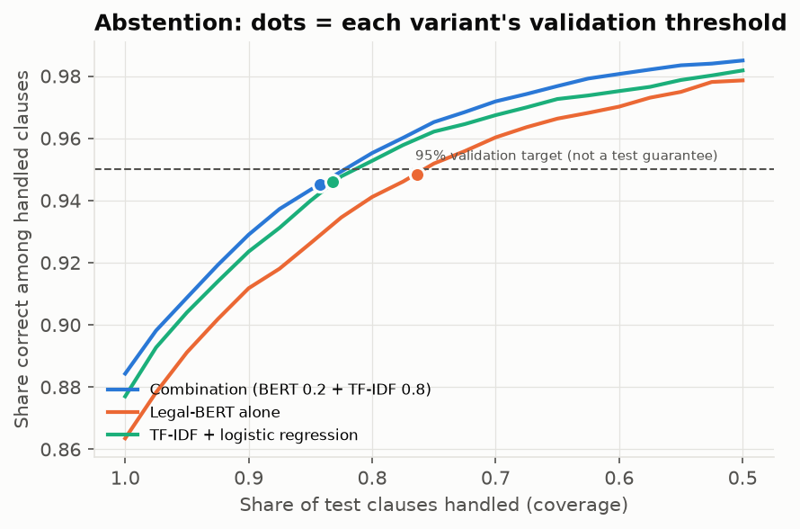
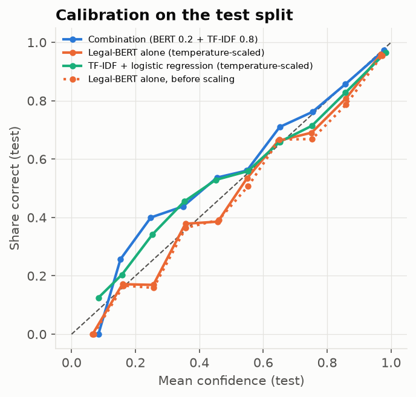
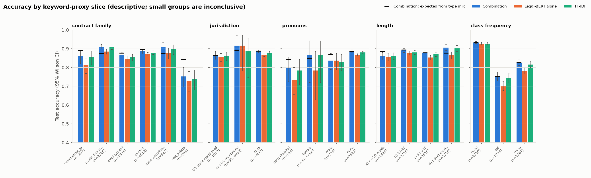

# Cœur NLP d'un assistant de revue de contrats

Classification de clauses contractuelles, recherche dans une banque de clauses et audit des modes de défaillance, sur LEDGAR (LexGLUE).

> **Statut : prototype de recherche.** Il fonctionne sur des clauses **anglaises** de contrats américains (déclarations SEC). Il n'est validé ni sur le droit européen, ni sur le français ou l'allemand. **Il ne remplace pas un avocat** (§11).

## En bref

Tous les chiffres viennent de [presentation/key_numbers.md](presentation/key_numbers.md), généré depuis `reports/` : chaque valeur y est donnée avec son fichier et sa clé JSON.

| Test LEDGAR (10 000 clauses) | micro-F1 [IC 95 %] | macro-F1 [IC 95 %] |
|---|---|---|
| **Système livré** : combinaison Legal-BERT (poids 0,2) + TF-IDF (0,8) | **88,43** [87,78 ; 89,06] | **82,84** [81,17 ; 83,68] |
| TF-IDF + régression logistique (baseline) | 87,70 [87,02 ; 88,37] | 82,19 [80,52 ; 83,00] |
| Legal-BERT fine-tuné seul (2 époques, 256 tokens) | 86,35 [85,66 ; 87,02] | 76,27 [75,18 ; 77,03] |

- **Gain de la combinaison sur TF-IDF : réel mais modeste.** +0,73 point de micro-F1 [+0,51 ; +0,98] et +0,65 point de macro-F1 [+0,31 ; +1,00].
- **Legal-BERT seul est sous TF-IDF**, surtout sur les classes rares.
- **Abstention.** Chaque variante a un seuil fixé sur la validation, avec une cible de 95 % de classifications correctes. Sur le test, la combinaison traite 84,2 % des clauses, dont 94,5 % sont correctement classées. La cible de 95 % n'est pas une garantie sur le test.
- **Recherche** clause → clauses similaires : P@1 77,4 %, P@10 66,4 % (pertinence = même label LEDGAR). La question « 30-day notice » **échoue** (§7).
- **Faiblesses** : classes rares, labels quasi synonymes, clauses de bail, préavis de N jours, types de clauses absents de LEDGAR.

**Remise et soutenance** : voir [§14](#14-remise-et-soutenance).

---

## Sommaire
1. [Problème et exigences](#1-problème-et-exigences) · 2. [Données](#2-données-ledgar) · 3. [Architecture](#3-architecture) · 4. [Reproduire](#4-reproduire-et-démontrer) · 5. [Entraînement](#5-entraînement--choix-provenance-hypothèses) · 6. [Classification](#6-résultats-de-classification) · 7. [Recherche](#7-recherche-dans-la-banque-de-clauses) · 8. [Audit](#8-audit-des-biais-et-des-défaillances) · 9. [LexGLUE](#9-comparaison-externe-lexglue) · 10. [Reproductibilité](#10-reproductibilité) · 11. [Usages](#11-usages-autorisés-et-interdits) · 12. [Limites](#12-limites-et-suite) · 13. [Versions](#13-versions-des-résultats) · 14. [Remise](#14-remise-et-soutenance)

## 1. Problème et exigences

Pendant une due diligence, un juriste lit chaque clause, en identifie le type, cherche des précédents dans la banque de clauses du cabinet et signale les formulations inhabituelles. Le cœur NLP doit :
1. **classer** chaque clause parmi les types de la check-list ;
2. **retrouver** des clauses proches, à partir d'une clause collée ou d'une question ;
3. **prouver** qu'il fonctionne (globalement, par type de clause, par type de contrat et de partie), et dire clairement ce pour quoi il ne doit pas servir.

Les clients européens exigent des résultats reproductibles et un audit des défaillances. D'où quatre règles :
- les paramètres sont choisis sur la **validation** uniquement ;
- les trois variantes sont rapportées ;
- le système s'abstient quand il n'est pas sûr ;
- les artefacts sont liés à leurs empreintes.

## 2. Données (LEDGAR)

`coastalcph/lex_glue/ledgar`, révision figée `c23fdff1…`. Ce sont des clauses de contrats déposés à la SEC. Le découpage est **chronologique** : train 60 000 (2016–2017), validation 10 000 (2018), test 10 000 (2019). Il y a **100 types de clauses** et une seule étiquette par clause. Exploration : [reports/eda.json](reports/eda.json).

| Constat | Valeur | Conséquence |
|---|---|---|
| Déséquilibre | *Governing Laws* 3 167 exemples, *Books* 23 (ratio 138) | macro-F1 + analyse tête / milieu / queue |
| Longueur | médiane 103 tokens ; 11,9 % > 256 ; 1,9 % > 512 | troncature à 256 tokens (§5) |
| Doublons | **282 clauses du test identiques à une clause du train** | scores aussi rapportés sans ces doublons |
| Dérive temporelle | Jensen-Shannon train/test 0,078 | le test mesure déjà un peu de dérive |
| Pronoms (proxy) | uniquement *he* 2 073 · uniquement *she* 201 · les deux 721 | genre déséquilibré |
| Juridiction (proxy) | État américain 6 159 · hors États-Unis 253 | quasi aucune clause européenne |
| **Types absents des 100 labels** (vérifié sur la liste) | RGPD / protection des données, force majeure, non-concurrence, non-sollicitation, exclusivité, **limitation de responsabilité**, audit | le système ne peut pas les reconnaître |

## 3. Architecture

Schémas détaillés : [presentation/architecture.md](presentation/architecture.md).

```
clause ─► Legal-BERT fine-tuné (256 tokens) ─► softmax(logits / T_bert) ──┐ ×0,2
      └─► TF-IDF 1-2 grammes + rég. logistique ─► softmax(logits / T_tfidf) ┤ ×0,8
                                                                            ▼
                  score max ≥ seuil de la variante ? → type prédit : sinon « à revoir par un juriste »

question ─► filtre « N jours » (clauses admissibles) ─► dense bge-small (cosinus) + BM25 (> 0) ─► RRF ─► top-k
```

Les **trois variantes** passent par la même interface ([`inference.py`](src/nlp_final_project/inference.py)), utilisée par l'évaluation, l'audit et la CLI `classify` :
- `ensemble` : la combinaison, système livré ;
- `bert` : Legal-BERT seul ;
- `tfidf` : le baseline.

La configuration d'inférence ([reports/inference_config.json](reports/inference_config.json)) contient l'ordre des labels, les empreintes, les températures, le poids et les seuils, tous choisis sur la validation.

| Module | Rôle |
|---|---|
| [`train.py`](src/nlp_final_project/train.py) | boucle PyTorch écrite à la main : lots groupés par longueur, AdamW + warm-up, checkpoints reprenables |
| [`baseline.py`](src/nlp_final_project/baseline.py) · [`evaluate.py`](src/nlp_final_project/evaluate.py) · [`metrics.py`](src/nlp_final_project/metrics.py) | baseline, évaluation, métriques, seuils |
| [`retrieval.py`](src/nlp_final_project/retrieval.py) | index dense + BM25 + RRF, filtre de durée, intégrité de l'index |
| [`audit.py`](src/nlp_final_project/audit.py) · [`perturb.py`](src/nlp_final_project/perturb.py) · [`slices.py`](src/nlp_final_project/slices.py) | groupes, contrefactuels, hors périmètre |
| [`fingerprint.py`](src/nlp_final_project/fingerprint.py) · [`manifest.py`](src/nlp_final_project/manifest.py) | caches auto-invalidants, manifeste de run |

## 4. Reproduire et démontrer

Prérequis : [uv](https://docs.astral.sh/uv/). Les dépendances sont verrouillées dans `uv.lock`. Toutes les commandes acceptent `--help` sans rien calculer. Durées mesurées sur Apple M3 16 Go.

| Étape | Commande | Durée |
|---|---|---|
| Environnement | `uv sync --frozen` | < 1 min (cache uv chaud) |
| Exploration | `uv run nlp-final-project eda` | ~1 min |
| Baseline TF-IDF | `uv run nlp-final-project baseline` | ~4 min (CPU) |
| Fine-tuning Legal-BERT | `uv run nlp-final-project train` | **~2 h 30** (GPU intégré) |
| Évaluation des 3 variantes | `uv run nlp-final-project evaluate` | ~4 min la 1re fois, ~15 s ensuite |
| Index + évaluation recherche | `uv run nlp-final-project index` | ~5 min si reconstruit |
| Audit | `uv run nlp-final-project audit` | ~5 min |
| Tout sauf l'entraînement | `uv run nlp-final-project all` | refuse de démarrer si un modèle manque ; **n'entraîne jamais** |
| Manifeste | `uv run nlp-final-project manifest` | ~10 s |
| Tests | `uv run pytest` | ~1 min 30 (92 tests) |
| Cohérence des rapports | `uv run python scripts/cross_checks.py --manifest` | ~20 s |

**Reprise de l'entraînement** :
- `train --resume` exige un checkpoint et **échoue s'il n'y en a pas** ;
- `train --resume-if-present` reprend si un checkpoint existe, sinon démarre un nouveau run ;
- une reprise est refusée si la configuration diffère du checkpoint (par exemple `--epochs 3` sur un run de 2 époques).

**Artefacts lourds** : poids (418 Mo), TF-IDF (139 Mo), index (128 Mo), logits. Ils sont dans `artifacts/`, exclu de Git. On les reconstruit avec `baseline`, `train`, `evaluate` puis `index`. Les rapports sont versionnés dans `reports/`.

Démonstration commentée, échec contrôlé compris : [presentation/demo.md](presentation/demo.md).

## 5. Entraînement : choix, provenance, hypothèses

| Choix | Valeur | Raison |
|---|---|---|
| Modèle | `nlpaueb/legal-bert-base-uncased` (révision `15b570cb…`) | LEDGAR est en anglais : CamemBERT (français) n'est pas adapté. Legal-BERT est pré-entraîné notamment sur des contrats américains. |
| Longueur | 256 tokens (88 % des clauses entières) | 512 saturait la mémoire partagée de 16 Go et doublait le coût |
| Budget | 2 époques (~1 h 15 chacune), une graine (42) | calcul limité sur portable |
| Optimisation | AdamW, lr 3e-5, warm-up 6 %, décroissance linéaire jusqu'à 0, batch 16, bfloat16 | recette BERT standard |

**Provenance** ([reports/training_provenance.md](reports/training_provenance.md)) :
- **Prouvé par les fichiers :** le modèle livré vient d'**un seul processus**, de l'étape 0 à l'étape 7 500 (146,5 min), **sans reprise**. `train.log` ne contient aucune ligne `resumed at`.
- **Trace déclarative :** le champ `resume: true` de `train_log.json` enregistre seulement l'option passée ; aucun checkpoint n'existait alors. Une première tentative avait été arrêtée sans checkpoint, d'après le journal de session (fichier de trace écrasé).
- **Testé sur CPU uniquement :** la reprise est testée sur un mini-modèle avec dropout (« interrompu puis repris = continu », 3 points d'interruption). Ce test a révélé et fait corriger une consommation du générateur aléatoire global par `DataLoader`. L'identité sur MPS / bfloat16 n'est pas démontrée.

**Pourquoi Legal-BERT seul est sous TF-IDF : des hypothèses à tester, pas des causes établies.**
- **Budget de 2 époques.**
  - Indices : le macro-F1 de validation montait encore nettement (74,0 → 77,6, définition de l'époque) ; le taux d'apprentissage est arrivé à 0 en 2 époques, contre 20 époques maximum dans LexGLUE ; les classes rares sont les plus touchées (queue : 61,9 % contre 74,3 %).
  - Non vérifié : une seule graine, pas d'époque 3.
- **Troncature à 256 tokens.**
  - Indice : sur les clauses de plus de 200 mots, BERT a 3,9 points d'exactitude de moins que TF-IDF, contre 0,3 point sur les clauses de 31 à 80 mots.
  - Limite : seules 11,9 % des clauses sont tronquées.
- **Non exclus** : hyperparamètres, variance entre graines, labels quasi synonymes.

## 6. Résultats de classification

**Protocole.** Températures, poids d'ensemble (grille 0..1 par pas de 0,05, meilleur macro-F1 de validation) et seuils sont choisis **sur la validation**. Le test ne sert qu'à évaluer.

**Définitions.**
- **Macro-F1 principal** : définition standard sur l'univers fixe des **100 labels**, avec `zero_division=0`. Elle équivaut à `f1_score(y, p, labels=range(100), average="macro", zero_division=0)`. La même définition sert pour les scores ponctuels, les bootstraps simples et appariés, et le choix du poids.
  - **Analyse de sensibilité** (jamais un score principal) : on peut aussi compter 1 pour un label absent à la fois de la vérité et des prédictions (`sensitivity_macro_f1_absent_both_counts_one`).
  - Sur le test, les 100 labels sont présents : les scores ponctuels ne bougent pas.
  - Sur la validation, *Books* est absent. BERT, qui ne le prédit jamais, obtient 76,80 en définition principale contre 77,80 en sensibilité.
- **Bootstrap** : 1 000 rééchantillonnages des **clauses**. Sans identifiant de contrat, la corrélation entre clauses d'un même contrat est ignorée : les intervalles sont probablement un peu trop étroits.
- **Seuil d'abstention** : plus bas seuil dont l'ensemble **réellement accepté par `>=`** atteint 95 % sur la validation. Les égalités de confiance sont prises en groupes entiers. S'il n'existe aucun seuil possible, il vaut `null` et la variante s'abstient sur tout.

| Variante | Test sans doublons train (n = 9 718) : micro / macro | Macro-F1 tête / milieu / queue | Validation micro / macro |
|---|---|---|---|
| **Combinaison** | 88,11 / 82,49 | 90,4 / 83,6 / 74,8 | 88,78 / 82,90 |
| TF-IDF | 87,36 / 81,83 | 89,8 / 82,8 / 74,3 | 87,97 / 81,88 |
| Legal-BERT | 86,14 / 76,10 | 89,6 / 77,7 / 61,9 | 86,37 / 76,80 |

**Comparaisons appariées** (mêmes clauses ; McNemar porte sur le taux d'erreur, **pas sur le macro-F1**) :

| | Δ micro-F1 [IC 95 %] | Δ macro-F1 [IC 95 %] | McNemar |
|---|---|---|---|
| Combinaison − TF-IDF | +0,73 [+0,51 ; +0,98] | +0,65 [+0,31 ; +1,00] | 106 contre 33, p = 4·10⁻¹⁰ |
| Combinaison − BERT | +2,08 [+1,54 ; +2,60] | +6,57 [+5,20 ; +7,51] | 466 contre 258, p = 9·10⁻¹⁵ |
| BERT − TF-IDF | −1,35 [−1,93 ; −0,77] | −5,92 [−6,88 ; −4,50] | 362 contre 497, p = 5·10⁻⁶ |

**Calibration et abstention** (chaque variante avec son propre seuil) :

| Variante | ECE test | Seuil | Couverture validation → test | Correctes parmi les clauses traitées (test) |
|---|---|---|---|---|
| Combinaison | 0,017 | 0,709 | 84,1 % → 84,2 % | **94,5 %** |
| Legal-BERT | 0,029 → 0,020 (T = 1,04) | 0,851 | 76,5 % → 76,4 % | 94,8 % |
| TF-IDF | 0,024 → 0,024 (T = 0,91) | 0,756 | 83,3 % → 83,2 % | 94,6 % |

**Erreurs de la combinaison.**
- Principales confusions : *Applicable Laws → Governing Laws* (33), *No Waivers → Waivers* (23), *Tax Withholdings → Withholdings* (20), *Modifications → Amendments* (18), *Integration → Entire Agreements* (17). Ce sont des labels quasi synonymes de la taxonomie.
- Classes les plus faibles (F1, effectif test) : *Assigns* 0,00 (4), *Applicable Laws* 0,27 (53), *Jurisdictions* 0,35 (29), *Venues* 0,51 (20).

Détail : [reports/eval_metrics.json](reports/eval_metrics.json), [reports/per_class_test.csv](reports/per_class_test.csv) (précision, rappel et F1 par variante).

 

## 7. Recherche dans la banque de clauses

**Banque** : 59 080 clauses du train, sans doublons exacts. **Encodeur** : `BAAI/bge-small-en-v1.5` (révision `5c38ec7c…`), recherche exacte. **Lexical** : BM25 vectorisé. **Fusion** : RRF (k = 60, profondeur 200).

**Règles de classement :**
1. Les filtres définissent d'abord les clauses **admissibles**.
2. Le dense classe toutes les admissibles ; BM25 seulement celles dont le score est strictement positif.
3. Une clause classée par aucun des deux signaux n'est **jamais renvoyée** : la liste peut contenir moins de k résultats, et la CLI le signale.
4. Les égalités sont départagées par la position dans la banque.
5. Avec plusieurs durées dans une requête : `--period-match any` (par défaut) ou `all`.

**A. Clause → clauses similaires** : 981 requêtes du test (au plus 10 par classe), pertinence = même label, doublons exacts de la requête retirés. P@k est divisé par k.

| Mode | P@1 | P@5 | P@10 | MRR@10 |
|---|---|---|---|---|
| Dense | 76,6 % | 68,5 % | 64,8 % | 0,814 |
| BM25 | 77,0 % | 68,4 % | 64,6 % | 0,817 |
| **Hybride** | **77,4 %** | **70,1 %** | **66,4 %** | **0,824** |

**B. 40 questions écrites à la main.**
- Elles ont été fixées avant de voir les résultats, mais **elles ont déjà été vues** depuis. Ce sont des tests de **non-régression**, pas une validation indépendante.
- La pertinence est approchée par le label : un résultat compte s'il porte un label accepté, sans vérifier qu'il répond vraiment à la question.
- Résultats question par question : [reports/retrieval_questions.json](reports/retrieval_questions.json).

| Mode | P@1 | `precision_at_10` (÷ 10) | `precision_among_returned` | Mention de la durée (4 questions, ÷ 10) |
|---|---|---|---|---|
| Dense | 85,0 % | 87,5 % | 87,5 % | 67,5 % |
| BM25 | 82,5 % | 83,0 % | 83,0 % | 90,0 % |
| Hybride | 92,5 % | 89,3 % | 89,3 % | 92,5 % |
| Hybride + filtre | 95,0 % | 89,0 % | 89,0 % | 100 % (par construction) |

**Échec contrôlé.** Avec « show me termination clauses with a 30-day notice period », le 1er résultat n'est pas pertinent et 1 seul des 10 premiers l'est. Le 1er résultat est une clause *Notices* : ses « 30 days » sont un délai pour notifier une « Good Reason », pas un préavis de résiliation.

Le filtre de durée vérifie seulement qu'une clause **mentionne** N jours :
- il ignore le rôle juridique de la durée (préavis, paiement, remédiation…) ;
- il ne distingue pas jours ouvrés et jours calendaires ;
- il ne gère ni « au moins / au plus », ni « thirty-one days ».

Ces limites sont fixées par des tests.

## 8. Audit des biais et des défaillances

Résultats complets : [reports/audit.json](reports/audit.json). Chaque variante utilise son propre seuil.

**Précautions de lecture.**
- Les groupes sont des **proxys par mots-clés**, ni des métadonnées ni des attributs personnels certifiés.
- Les groupes de moins de 100 clauses ne permettent aucune conclusion d'équité.
- L'écart « attendu d'après le mix de types » est **descriptif**, pas causal.

| Constat (combinaison) | Valeur |
|---|---|
| **Clauses de bail** (n = 266) | exactitude 75,2 % [69,7 ; 80,0] contre 84,3 % attendu (−9,2 pt) ; **87,6 %** de correctes parmi les clauses traitées. C'est le défaut le plus net, présent dans les 3 variantes. |
| **Classes de queue** (n = 1 283) | 84,3 % de correctes parmi les clauses traitées : l'abstention ne suffit pas |
| Pronoms *she* (n = 37) / hors États-Unis (n = 36) | trop petits pour conclure |
| Contrefactuels (le type change ?) | genre 2,3 % · juridiction américaine → européenne 3,6 % · $ → EUR 0,0 % · orthographe britannique 2,2 % · noms européens 0,8 % · bruit OCR 5,4 % |
| Hors périmètre (8 entrées) | la combinaison s'abstient sur les 8 ; **BERT seul classe la clause RGPD en « General » à 0,90** |
| Recherche | P@10 bail 59,9 % contre crédit 79,6 % ; la permutation de genre change les précédents montrés (Jaccard 0,85) |

Exemple de basculement : *Governing Laws* devient *Waiver Of Jury Trials* quand « Delaware » est remplacé par une juridiction européenne. Remplacer une juridiction ou une devise **change le contenu juridique** : un type stable ne garantit pas une clause équivalente. **Un seuil de confiance ne garantit pas de détecter les entrées hors périmètre.**



## 9. Comparaison externe (LexGLUE)

Source : Chalkidis et al., ACL 2022, [arXiv:2110.00976](https://arxiv.org/abs/2110.00976) v4, tableau 3. Scores test LEDGAR (micro-F1 / macro-F1) : TF-IDF + SVM 87,0 / 81,4 ; BERT 87,6 / 81,8 ; **Legal-BERT 88,2 / 83,0**.

C'est le même test, mais **un autre protocole** :
- LexGLUE : jusqu'à 20 époques avec arrêt anticipé, 512 tokens, meilleure de 5 graines, SVM sur 1-3 grammes avec recherche de grille ;
- ici : 2 époques, 256 tokens, une seule graine.

La comparaison est donc indicative : notre baseline est du même ordre que le leur, et notre Legal-BERT est en dessous.

## 10. Reproductibilité

| Élément | Valeur |
|---|---|
| Environnement | `uv.lock` ; Python 3.14.0b4 (**version bêta**), torch 2.14.1, transformers 5.20.2, datasets 5.1.0, scikit-learn 1.9.1 |
| Révisions | LEDGAR `c23fdff1…`, Legal-BERT `15b570cb…`, bge-small `5c38ec7c…` ([`config.py`](src/nlp_final_project/config.py)) |
| Matériel | Apple M3 16 Go, MPS, bfloat16 pour BERT |
| Manifeste | [reports/run_manifest.json](reports/run_manifest.json) : commit, état Git, versions, empreintes des artefacts et des rapports, commandes et statuts. Se régénère avec `nlp-final-project manifest`. Aucun chemin absolu. |
| Caches de logits | clé = poids + tokenizer + **contexte numérique** (appareil, précision, versions) + données + schéma ; passer du CPU au GPU **recalcule** |
| Index | `meta.json` contient le SHA-256, la taille et la forme des 3 fichiers ; toute incohérence est expliquée sur stderr et l'index est reconstruit. Réutilisé d'un appareil à l'autre par choix (écart signalé). |
| Reconstruction propre testée | copie neuve + `uv sync --frozen` : 80 tests réussis et 12 ignorés sans artefacts, puis 92 réussis avec les artefacts liés (empreintes inchangées). **Même machine, caches uv/HF partagés : pas de preuve de reproductibilité inter-machine.** |
| Déterminisme | logits recalculés identiques bit à bit sur M3 ; CPU contre M3 : écart de probabilité ≤ 0,012, aucun label changé (200 clauses) ; un ré-entraînement ne serait pas identique bit à bit |

**Tests** (`uv run pytest`, 92) :

| Fichier | Artefacts | Contenu |
|---|---|---|
| `test_units.py` (41) | non | seuils, macro-F1 (contre sklearn, classe disparue, cohérence avec le bootstrap), classement filtré, durées, BM25, perturbations, caches |
| `test_integrity.py` (15) | non | sorties TF-IDF (ordre, classe manquante), corruption de chaque fichier d'index, reprise stricte / `--resume-if-present` |
| `test_cli.py` (20) | non | `--help` de chaque commande sans écriture, arguments invalides, schéma du manifeste |
| `test_resume.py` (4) | non (CPU) | reprise = run continu |
| `test_artifacts.py` (12) | **oui** | ordre des labels, poids et seuils sur validation, macro-F1 standard, reproduction des scores, CLI réelle |

## 11. Usages autorisés et interdits

**Usage prévu** : aide au tri de clauses **anglaises** de type SEC, avec relecture humaine systématique. Les clauses sous le seuil vont à un juriste.

**Ne pas utiliser pour :**
- décider seul du type ou de la portée d'une clause : **pas de substitut à un avocat** ;
- le droit européen ou une autre juridiction : non validé ;
- le français, l'allemand ou toute autre langue que l'anglais : aucune garantie ;
- détecter les risques ou les clauses abusives de façon exhaustive : le système classe des types, il n'évalue pas la conformité ;
- les types absents de LEDGAR (RGPD, force majeure, non-concurrence, limitation de responsabilité…) ;
- retrouver un préavis précis : le filtre de durée n'est pas sémantique ;
- tirer des conclusions d'équité sur des personnes : l'audit repose sur des proxys.

## 12. Limites et suite

- **Classement :** BERT seul est sous TF-IDF, et la combinaison n'apporte qu'environ 0,7 point. Les labels quasi synonymes plafonnent les scores ; les clauses de bail et les classes rares restent faibles.
- **Recherche :** la notion de préavis n'est pas comprise. Il faudrait une extraction structurée (rôle + durée + type de jours).
- **Reproductibilité :** une seule graine, une seule machine, Python en version bêta.
- **Expérience proposée, séparée et soumise à accord :** comparer 256 et 512 tokens et 2 contre davantage d'époques avec arrêt anticipé, sur plusieurs graines, selon le même protocole (paramètres sur la validation, test consulté une seule fois). Cela demande plusieurs heures par run.
