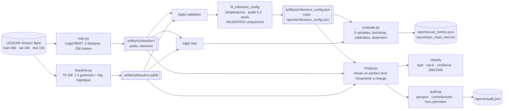
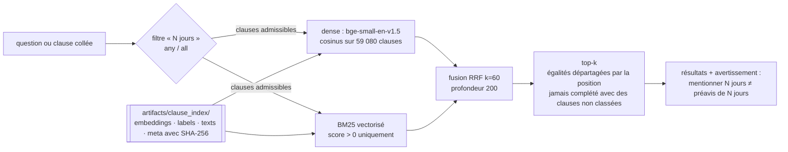

# Architecture

## Classification : des données à l'inférence

## Recherche : de la requête aux résultats

## Ce qui est versionné, ce qui ne l'est pas

| Versionné (Git) | Exclu de Git (`artifacts/`, reconstruit par les commandes) |
|---|---|
| code `src/`, tests `tests/`, scripts `scripts/` | poids Legal-BERT (418 Mo), checkpoint (1,2 Go) |
| `reports/*.json`, `*.csv`, `*.md`, figures, archives, `validation_logs/` | `baseline.joblib` (139 Mo) |
| `reports/inference_config.json` (copie) | logits en cache (`*_logits.npz`), avec leur empreinte |
| `reports/run_manifest.json` (empreintes de tous les artefacts) | index de recherche (128 Mo) |
| `presentation/` | journaux d'exécution (`*.log`) |
